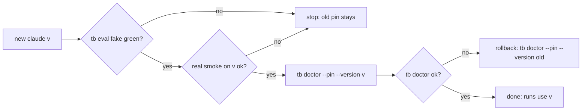
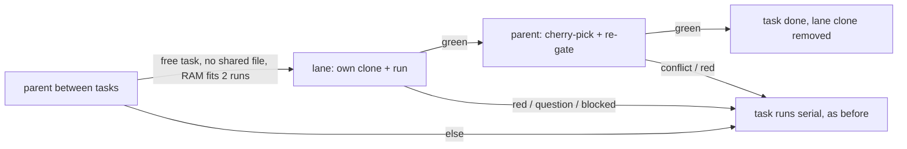
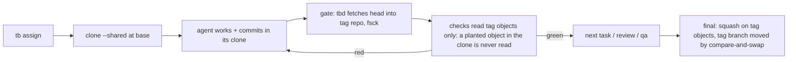
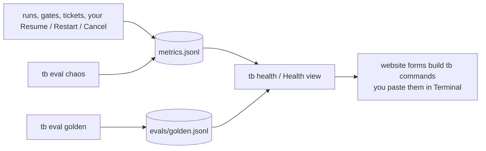

# taskboard

Local Mac task board + agent pipeline daemon. `tbd` = one daemon on 127.0.0.1: reminders, flow tickets, `claude -p` runs with recovery. `tb` = CLI over tbd HTTP. `tb open` = board UI in browser.

## Pin upgrade (new claude version)

Runs use a pinned copy of claude (`~/.taskboard/bin/claude-<v>`), never the self-updating one. New version `<v>` → steps below, in order. Step fails → stop, old pin stays.

1. Fake suite, no usage cost: `bin/tb eval fake` → exit 0.
2. Real smoke on `<v>`, before switch: `CLAUDE_BIN=~/.local/share/claude/versions/<v> node scripts/contain-smoke.js cmds-on edit-on`. Each summary: `escaped_home` empty, `secrets_in_transcript` 0, every `changed` false.
3. Switch: `tb doctor --pin --version <v>`. Copies `~/.local/share/claude/versions/<v>` to `~/.taskboard/bin/claude-<v>`, checks codesign + Team ID, sets `claude_bin`.
4. Check: `tb doctor` → `doctor: ok`.

Rollback: `tb doctor --pin --version <old>` (old copy still in `~/.taskboard/bin/`).

Default pin for new installs: `DEFAULT_PIN` in `lib/util.js` (now 2.1.302).

## Parallel lanes (code tickets)

Off by default (`max_concurrent: 1`). On: set `"max_concurrent": 2` in `~/.taskboard/config.json` (read at start only), restart tbd `launchctl kickstart -k gui/$(id -u)/local.taskboard`, check `tb doctor`. Note: `max_concurrent` also lets 2 tickets run at once. A plan task with no `blocked_by` and no file shared with the running task may run as a lane: own clone, own run, then tbd merges it back.

- RAM: a lane starts only when memory pressure is normal and 2 working runs fit (about 2.5 GB free). Else the task runs serial.
- See lanes: `tb show <parent>` (lanes table) or the board drawer. A lane is no flow of its own: act on the parent (`409 … act on the parent`).
- Parent with no task left waits for its lanes (`waiting: lanes`).

## Ticket isolation (code tickets)

Each ticket gets its own `git clone --shared` of the tag repo (`~/.taskboard/worktrees/<id>`). The agent writes only its clone. The tag repo `.git` is read-only to every agent: it reads the objects, never refs or config. Only tbd moves commits back (fetch + fsck), into `refs/tb/<id>/*`.

- Pin: tbd refuses to run git in a clone whose `.git` is a link, has `commondir`, a changed `config` or `alternates`, or a linked `packed-refs` (refusal text never echoes git output).
- Tickets made before this change keep their old worktree and keep working.
- Needs git 2.49+ (`clone --revision`); `tb doctor` checks it.
- Local Postgres: TCP loopback needs a password (scram); the socket is out of agent reach. A tag without `db: local` must hold no DB password in its env files (`tb doctor --tag` fails it). `tb doctor` shows `pg_wall`.

### Full access by default, Sandbox toggle

A code run works like your terminal: it reads your live `~/.claude/CLAUDE.md` and FUNDAMENTALS, the repo `CLAUDE.md`, `CLAUDE.local.md` and `AGENTS.md`, loads your user and plugin skills and hooks (OMC off), may use 2 subagents, and asks you questions from any step (lavish page; the same session resumes). A seatbelt wall (`full_access_wall`, on by default) still blocks `~/.ssh`, every `.env` but the tag's copied env files, and gh / git / netrc / AWS credentials. Browser checks run through `bin/tb-chrome` (working and QA), outside Claude's seatbelt but under a profile built from the same wall (only node, Chrome and the shell run; loopback only the ticket's ports and the tag's qa ports).

- Untrusted input in the task (an issue, a pasted log, a third-party file)? Turn Sandbox on: `tb new … --sandbox`, the New Flow checkbox, or the page switch on a backlog ticket. That is the old locked run. Turning it off is the CLI only: `tb set-sandbox <id> off`.
- What full access can still do: run as you inside the wall (internet open, your other repos readable) and stop another of your processes. Push stays yours.
- Settings page or `tb config`: models per step, tickets at once, subagents, default skills. Steering: note box, Pause and Copy (`cd <worktree> && claude --resume <uuid>` for your terminal), Hand Back.

## Health, evals and drills

`tb health` (or the Health view in the board) shows the reliability targets as x / y over the last 30 days: interruptions recovered without you, runs you had to Resume or Restart, gate failures that were infra, false stall alerts, rework, hands-off after approve, fix-of tickets, golden score, tbd memory. Computed on request from `~/.taskboard/metrics.jsonl` (rotates at 32 MB into `metrics.1.jsonl`), no timer.

- `tb health --days 7`, `tb health --drills` (drill log, paged).
- `tb eval golden --dry`: every eval harness with fake claude, no cost. `--real` prints the cost and needs `--yes`; the score is saved in `~/.taskboard/evals/` before it is posted, so `--record <file>` can post it again if tbd was down.
- `tb eval chaos <drill> [<id>]`: kill-tbd, kill-claude, restart, freeze, disk, memory, wifi, lid, reboot. Acts only on a live run; records pass or fail.
- Website Maintenance and Tags: Add tag, Check setup, Clean up and Run evals build the exact `tb …` command (shell-quoted) for you to paste. These commands run outside the agent sandbox, so the website never runs them itself.
