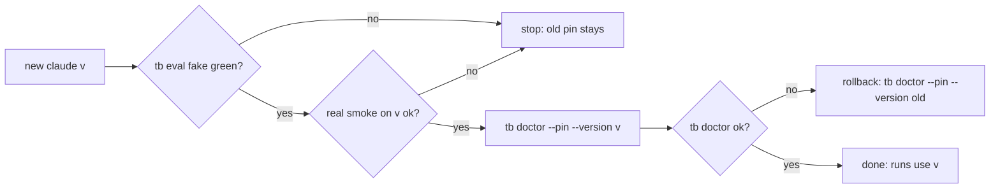
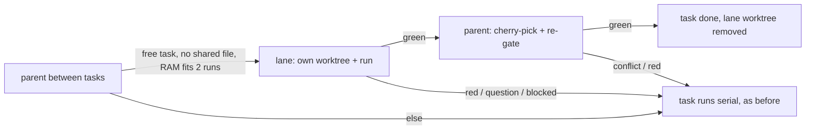

# taskboard

Local Mac task board + agent pipeline daemon. `tbd` = one daemon on 127.0.0.1: reminders, flow tickets, `claude -p` runs with recovery. `tb` = CLI over tbd HTTP. `tb open` = board UI in browser.

## Pin upgrade (new claude version)

Runs use a pinned copy of claude (`~/.taskboard/bin/claude-<v>`), never the self-updating one. New version `<v>` → steps below, in order. Step fails → stop, old pin stays.

1. Fake suite, no usage cost: `bin/tb eval fake` → exit 0.
2. Real smoke on `<v>`, before switch: `CLAUDE_BIN=~/.local/share/claude/versions/<v> node scripts/contain-smoke.js cmds-on edit-on`. Each summary: `escaped_home` empty, `secrets_in_transcript` 0, every `changed` false.
3. Switch: `tb doctor --pin --version <v>`. Copies `~/.local/share/claude/versions/<v>` to `~/.taskboard/bin/claude-<v>`, checks codesign + Team ID, sets `claude_bin`.
4. Check: `tb doctor` → `doctor: ok`.

Rollback: `tb doctor --pin --version <old>` (old copy still in `~/.taskboard/bin/`).

Default pin for new installs: `DEFAULT_PIN` in `lib/util.js` (now 2.1.295).

## Parallel lanes (code tickets)

Off by default (`max_concurrent: 1`). On: set `"max_concurrent": 2` in `~/.taskboard/config.json` (read at start only), restart tbd `launchctl kickstart -k gui/$(id -u)/local.taskboard`, check `tb doctor`. Note: `max_concurrent` also lets 2 tickets run at once. A plan task with no `blocked_by` and no file shared with the running task may run as a lane: own worktree, own run, then tbd merges it back.

- RAM: a lane starts only when memory pressure is normal and 2 working runs fit (about 2.5 GB free). Else the task runs serial.
- See lanes: `tb show <parent>` (lanes table) or the board drawer. A lane is no flow of its own: act on the parent (`409 … act on the parent`).
- Parent with no task left waits for its lanes (`waiting: lanes`).
