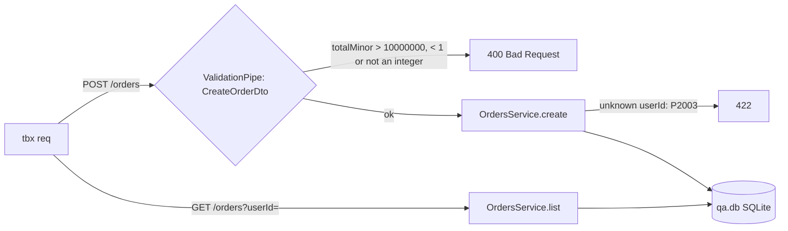

# QA: maximum order total on POST /orders

- Change: `src/orders/orders.dto.ts` (`MAX_TOTAL_MINOR`, `@Max` on `CreateOrderDto.totalMinor`), `test/orders.e2e-spec.ts` (two e2e tests), `README.md`
- App: built with `tsc -p tsconfig.build.json --outDir docs/verification/build`, run with `node docs/verification/build/main.js` on the qa port 50461
- Data: `docs/verification/qa.db` from the migrations + `prisma/seed.ts` (50 users, 5 orders each)
- Calls: every request went through `tbx req` (rec ids below).

## Cases

### TC-1: a total at the maximum is accepted (positive, A2)
- Source: A2
- Steps: `tbx req POST /orders -d '{"userId":3,"totalMinor":10000000}'`
- Expect: 201 with the stored order, `totalMinor` 10000000
- Recs: 1.1
- Seen: 201 `{"id":251,"userId":3,"totalMinor":10000000,"status":"pending",...}`. **PASS**

### TC-2: a total above the maximum is refused and nothing is stored (negative, A1)
- Source: `src/orders/orders.dto.ts:39`
- Steps: `tbx req GET /orders?userId=4&limit=100`; `tbx req POST /orders -d '{"userId":4,"totalMinor":10000001}'`; `tbx req GET /orders?userId=4&limit=100`
- Expect: 400 `totalMinor must not be greater than 10000000`; user 4 has the same 5 orders before and after
- Recs: 1.2, 1.3, 1.4
- Seen: 5 orders (ids 20, 19, 18, 17, 16), then 400 with that message, then the same 5 orders. **PASS**

### TC-3: the lower bound holds as before (negative, A3)
- Source: A3
- Steps: `tbx req POST /orders -d '{"userId":2,"totalMinor":0}'`; `tbx req POST /orders -d '{"userId":2,"totalMinor":10.5}'`
- Expect: 400 each
- Recs: 1.5, 1.6
- Seen: 400 `totalMinor must not be less than 1`; 400 `totalMinor must be an integer number`. **PASS**

### TC-4: an unknown user is still refused (negative, A3)
- Source: A3
- Steps: `tbx req POST /orders -d '{"userId":9999,"totalMinor":100}'`
- Expect: 422
- Recs: 1.7
- Seen: 422 `user 9999 does not exist`. **PASS**

## Summary

| case | acceptance | kind | result | recs |
|---|---|---|---|---|
| TC-1 | A2 | positive | PASS | 1.1 |
| TC-2 | A1 | negative | PASS | 1.2, 1.3, 1.4 |
| TC-3 | A3 | negative | PASS | 1.5, 1.6 |
| TC-4 | A3 | negative | PASS | 1.7 |

**Verdict:** PASS
