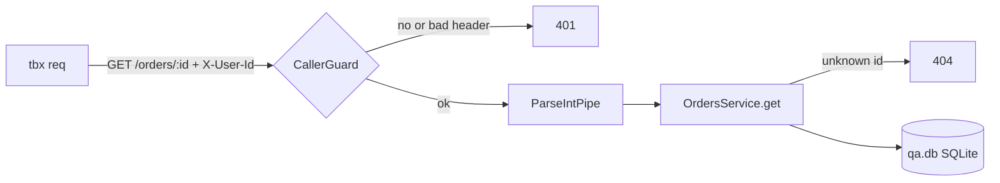

# QA: GET /orders/:id for the caller

- Change: `src/common/caller.guard.ts` (new `CallerGuard`), `src/orders/orders.controller.ts` (`GET /orders/:id`), `src/orders/orders.service.ts` (`OrdersService.get`), `test/orders.e2e-spec.ts`, `README.md`
- App: built with `tsc -p tsconfig.build.json --outDir docs/verification/build`, run with `node docs/verification/build/main.js` on the qa port 50461
- Data: `docs/verification/qa.db` from the migrations + `prisma/seed.ts` (50 users, 5 orders each: user 3 owns orders 11-15)
- Calls: every request went through `tbx req` (rec ids below).

## Cases

### TC-1: the owner gets the order (positive, A1)
- Source: `src/orders/orders.controller.ts:22`
- Steps: `tbx req GET /orders/11 -H 'X-User-Id: 3'`
- Expect: 200 with order 11 of user 3
- Recs: 1.1
- Seen: 200 `{"id":11,"userId":3,"totalMinor":1111,"status":"paid","createdAt":"2026-01-04T00:00:00.000Z"}`. **PASS**

### TC-2: no caller, or a bad one, is refused (negative, A2)
- Source: `src/common/caller.guard.ts:10`
- Steps: `tbx req GET /orders/11`; `tbx req GET /orders/11 -H 'X-User-Id: abc'`
- Expect: 401 each
- Recs: 1.2, 1.3
- Seen: 401 `X-User-Id must be a positive integer` twice. **PASS**

### TC-3: an unknown order is a 404 (negative, A3)
- Source: `src/orders/orders.service.ts:21`
- Steps: `tbx req GET /orders/99999 -H 'X-User-Id: 3'`
- Expect: 404
- Recs: 1.4
- Seen: 404 `order 99999 not found`. **PASS**

## Summary

| case | acceptance | kind | result | recs |
|---|---|---|---|---|
| TC-1 | A1 | positive | PASS | 1.1 |
| TC-2 | A2 | negative | PASS | 1.2, 1.3 |
| TC-3 | A3 | negative | PASS | 1.4 |

**Verdict:** PASS
