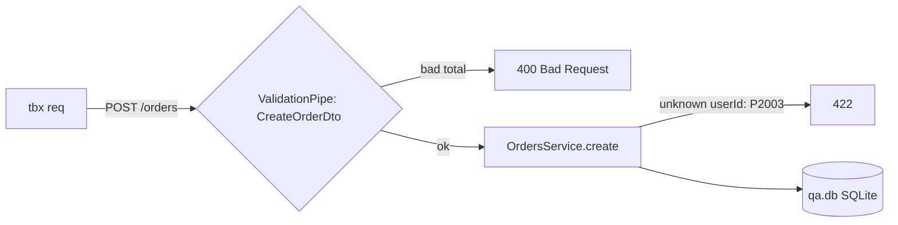

# QA: maximum order total on POST /orders

- Change: `src/orders/orders.dto.ts` (`MAX_TOTAL_MINOR`, `@Max` on `CreateOrderDto.totalMinor`), `test/orders.e2e-spec.ts` (one e2e test), `README.md`
- App: built with `tsc -p tsconfig.build.json --outDir docs/verification/build`, run with `node docs/verification/build/main.js` on the qa port 50461
- Data: `docs/verification/qa.db` from the migrations + `prisma/seed.ts` (50 users, 5 orders each)
- Calls: every request went through `tbx req` (rec ids below).

## Cases

### TC-1: a total at the maximum is accepted (positive, A2)
- Source: A2
- Steps: `tbx req POST /orders -d '{"userId":3,"totalMinor":10000000}'`
- Expect: 201 with the stored order, `totalMinor` 10000000
- Recs: 1.1
- Seen: 201 `{"id":251,"userId":3,"totalMinor":10000000,"status":"pending",...}`. **PASS**

### TC-2: a total out of bounds is refused (negative, A1)
- Source: A1
- Steps: `tbx req POST /orders -d '{"userId":4,"totalMinor":0}'`
- Expect: 400, no order stored
- Recs: 1.2
- Seen: 400 `totalMinor must not be less than 1`. **PASS**

### TC-3: an unknown user is still refused (negative, A3)
- Source: A3
- Steps: `tbx req POST /orders -d '{"userId":9999,"totalMinor":100}'`
- Expect: 422
- Recs: 1.3
- Seen: 422 `user 9999 does not exist`. **PASS**

## Summary

| case | acceptance | kind | result | recs |
|---|---|---|---|---|
| TC-1 | A2 | positive | PASS | 1.1 |
| TC-2 | A1 | negative | PASS | 1.2 |
| TC-3 | A3 | negative | PASS | 1.3 |

Every new acceptance criterion (A1, A2) has a passing case.

**Verdict:** PASS
